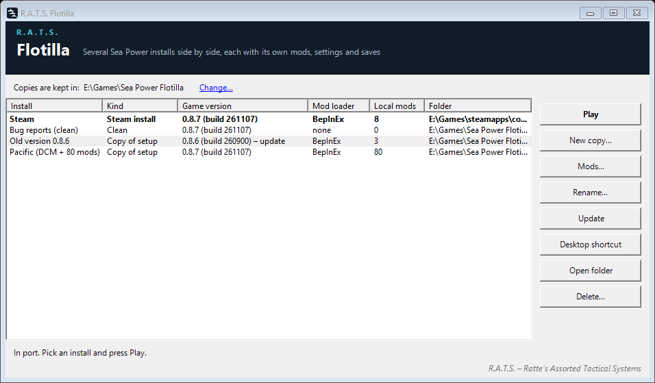

# Sea Power: R.A.T.S. Flotilla

A Windows app that keeps several Sea Power installs on one PC, each with its own mods, settings and saves. Keep one clean for
bug reports, one with a big mod set, one for trying things, and leave your Steam install as it is.

- Not a game mod: no mod loader needed. Its entry in the game's Mods menu does nothing and can stay off.
- Starts the game only when you press Play.
- Workshop: [R.A.T.S. Flotilla](https://steamcommunity.com/sharedfiles/filedetails/?id=3836624723); step by step: [Flotilla guide](https://steamcommunity.com/sharedfiles/filedetails/?id=3836683383)
- Bugs, ideas, questions: [R.A.T.S. feedback board](https://hub.sewerlabs.dev/s/flotilla)

## What it does

### Copies

- **New copy...** makes a copy of the game, about 19 GB either way:
  - Clean: only the game's own files as Steam installs them. No mod loader, no local mods, no missions, fresh settings, no mods enabled.
  - Copy of my setup: everything of your Steam install: BepInEx, local mods, missions, settings, enabled mods with load order, saves.
- **Rename...** renames a copy. A desktop shortcut it has follows the new name.
- **Delete...** removes a copy for good. The Steam install is never deleted or changed.
- Copies go to `Sea Power Flotilla` next to the Steam library that holds the game (for example `D:\SteamLibrary\Sea Power Flotilla`). **Change...** picks another folder.

### Playing

- **Play** starts the selected install. Steam must be running. Flotilla can be closed while you play.
- **Desktop shortcut** makes `Sea Power (<name>)` on the desktop, which starts that copy directly.
- Only one Sea Power at a time: do not start the game from the Steam library while a copy runs, it would use that copy's settings.

### Mods

**Mods...** works on one copy. A copy has to be started once first.

- Switch mods on or off and set their order.
- Add a mod (a folder or a .zip) to this copy only, or remove it again.
- Shows which game version each mod was made for.
- **Keep in this copy** gives the copy its own copy of a Workshop mod:
  - Files go into the copy as `<name> (kept)`; the Workshop entry is switched off there.
  - Steam updates and unsubscribing no longer change it in that copy. Other copies still get the updates.
  - The list shows when it was kept and when the Workshop has a newer download.
- **Refresh from Workshop** replaces a kept mod with the Workshop download as it is now. It stays kept.
- **Use Workshop again** deletes the kept files and switches the Workshop entry back on at the same place in the load order.
- A mod added here exists in that copy alone. Keep one copy per game version (and do not press Update on it) to give each version its own mods.
- Workshop subscriptions belong to your Steam account, so every copy sees every subscribed item. Which are enabled, and in what order, is kept per copy. A clean copy starts with none enabled.

### Updating

- **Update** brings a copy's game files up to date after Steam updated the game. Its mod loader, mods, missions, settings and saves stay.
- Steam updates only its own install. The list marks copies that are behind. You can keep a copy on the older version on purpose.
- After Update moves a copy to a new game version, Flotilla checks every mod that is on in it, the way the game does (`[Compatibility]` in `_info.ini`):
  - A kept mod that does not fit, whose Workshop version does, is refreshed (ticked).
  - A mod with no fitting version can be switched off in that copy (not ticked by default: the game only warns about such a mod and runs it if you press Ignore).
  - **Leave as is** changes nothing.
- **Check game version...** in **Mods...** runs the same check at any time.
- For a specific game version in a copy: pick that branch in Steam (Sea Power, Properties, Betas), press Update on the copy, switch Steam back. Do not press Update on that copy again unless Steam is on the branch you want in it.
- The Workshop has only each mod's newest version. An older one exists only where you kept it.
- Code mods: Keel loads only the mods switched on, so the kept copy runs. Anchor Chain loads every mod DLL it finds and takes the newest version, so the Workshop version can still win there; unsubscribe from it, or use Keel in that copy.

### Other

- Steam Cloud syncs the Steam install only. Window size and monitor are shared by all installs.
- If the PC goes off while a copy runs, your Steam install's settings come back the next time you open Flotilla or start a copy.
- Details (where Sea Power keeps what, the data folder switch, what Update touches): [docs/how-it-works.md](docs/how-it-works.md).

## Install

- Download `SeaPowerFlotilla-<version>.zip` from [Releases](https://github.com/struckl/SeaPowerFlotilla/releases), unzip it to a folder that stays (desktop shortcuts point there) and start `SeaPowerFlotilla.exe`.
- Or subscribe on the Workshop and start `SeaPowerFlotilla.exe` once from the item's folder. It moves to `%LOCALAPPDATA%\R.A.T.S. Flotilla\App` and picks up newer Workshop versions by itself.
- Needs .NET Framework 4.8, which Windows 10 and 11 have. No admin rights, no Steam setup.
- The exe is not signed, so Windows may say "unknown publisher": More info > Run anyway.

## Settings

- None to edit. The copy folder is chosen with **Change...** in the main window.

## Compatibility

- Workshop item declares game 0.8.7 up to (not including) 0.10.0.
- Run with the game on build 261107 (copy made, started through Flotilla, Steam data folder back unchanged).
- 0.3.1 was run on a copy of a full setup: copy, Keep, Save, Refresh, Update to the public beta and back, Steam install untouched. The windows themselves were not clicked through.

## Feedback

- [R.A.T.S. feedback board](https://hub.sewerlabs.dev/s/flotilla)

## Building

- `powershell tools/package.ps1` builds, runs the offline tests and writes `dist/SeaPowerFlotilla-<version>.zip`.
- Needs the .NET SDK 8 or newer (it builds the .NET Framework 4.8 exe through the reference-assemblies package).
- It uses no code from the Keel repo.
- `tools/make-icon.py` draws the icon (Pillow).

## Layout

| Path | What |
|---|---|
| `src/Flotilla` | The app |
| `tests/Flotilla.Tests` | Offline tests: every step runs against a fake install and a fake data folder in the temp folder, never the game |
| `tools/` | `package.ps1`, `make-icon.py` |
| `docs/` | `how-it-works.md`, the picture |
| `workshop/` | Workshop page text and pictures |

## Licenses and credits

- [R.A.T.S. Source License](LICENSE): read it, fork it, send fixes; no re-uploads, no reuse in other projects.
- Not affiliated with Triassic Games or MicroProse.

*R.A.T.S. - Ratte's Assorted Tactical Systems*
