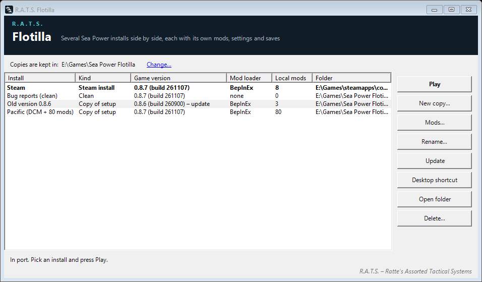

# Sea Power: R.A.T.S. Flotilla

*R.A.T.S. – Reconnaissance, Acoustics, Terrain & Signals*

Several Sea Power installs on one PC, side by side, each with its own mods, settings and saves. Keep one bone-clean
for bug reports, one loaded with a big mod set, one for trying things out, and keep your Steam install as it is.



## Get it

Download `SeaPowerFlotilla-<version>.zip` from [Releases](https://github.com/struckl/SeaPowerFlotilla/releases), unzip it to a
folder that stays (desktop shortcuts point there) and start `SeaPowerFlotilla.exe`. Nothing to install: it needs .NET Framework 4.8,
which every Windows 10 and 11 has. The exe is not signed, so Windows may say "unknown publisher": *More info* → *Run anyway*.

It is not a game mod: it does not go into the game folder and is not on the Steam Workshop.

## Use

| Button | What it does |
|---|---|
| **New copy...** | **Clean**: only the game's own files as Steam installs them: no mod loader, no local mods, no missions, fresh settings with no mods enabled. **Copy of my setup**: everything of your Steam install: BepInEx, local mods, missions, settings, the enabled mods with their load order, saves. About 19 GB either way. |
| **Play** | Starts the selected install (Steam must be running). Flotilla can be closed while you play. |
| **Mods...** | For one copy: switch mods on or off, set their order, add a mod (a folder or a .zip) to this copy only, remove it again. Shows which game version each mod was made for. A copy has to be started once first. |
| **Rename...** | Gives a copy a name that says what it is for. A desktop shortcut it already has follows the new name. |
| **Update** | After Steam updated the game: brings the copy's game files up to date. Its mod loader, mods, missions, settings and saves stay. |
| **Desktop shortcut** | `Sea Power (<name>)` on the desktop, starts that copy directly. |
| **Delete...** | Removes a copy for good. The Steam install is never deleted or changed. |

Copies go to `Sea Power Flotilla` next to the Steam library that holds the game (for example `D:\SteamLibrary\Sea Power Flotilla`);
**Change...** picks another folder. Steam needs no setup, and Flotilla needs no admin rights.

## Good to know

- **Workshop subscriptions** belong to your Steam account, so every copy sees every subscribed item. Which ones are enabled,
  and in what order, is kept per copy (the game keeps it with the settings). A clean copy starts with none enabled.
- **A mod for one game version only**: a mod added with **Mods...** exists in that copy alone. Keep one copy per game version (and do not press **Update** on it), and each version has its own mods.
- **One Sea Power at a time.** Do not start Sea Power from the Steam library while a copy runs: it would use that copy's settings.
- **Game updates**: Steam updates only its own install; the list marks copies that are behind. Press **Update**, or keep a copy on
  the older version on purpose (handy before switching Steam to a beta branch).
- **Steam Cloud** syncs the Steam install only. Window size and monitor are shared by all installs.
- If the PC goes off while a copy runs, your Steam install's settings come back the next time you open Flotilla or start a copy.

How it works in detail (where Sea Power keeps what, the data folder switch, what Update touches): [docs/how-it-works.md](docs/how-it-works.md).

## Build

```
powershell tools/package.ps1      # builds, runs the offline tests, writes dist/SeaPowerFlotilla-<version>.zip
```

.NET SDK 8 or newer (it builds the .NET Framework 4.8 exe through the reference-assemblies package). The tests
(`tests/Flotilla.Tests`) run every step against a fake install and a fake data folder in the temp folder and never touch the game.
`tools/make-icon.py` draws the icon (Pillow).

## License

MIT, see [LICENSE](LICENSE). Not affiliated with Triassic Games or MicroProse.

*R.A.T.S. – Ratte's Assorted Tactical Systems*
